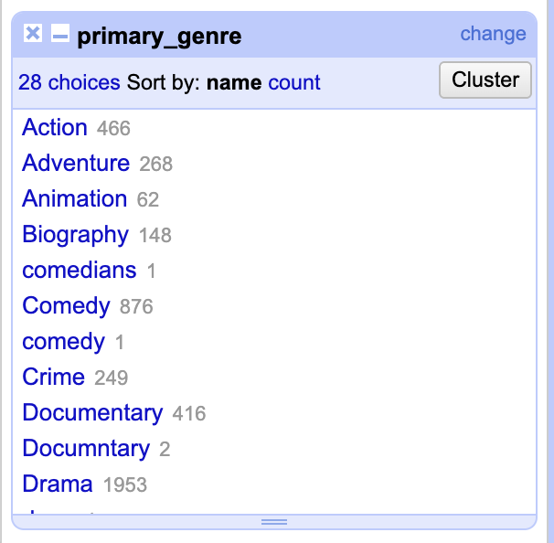
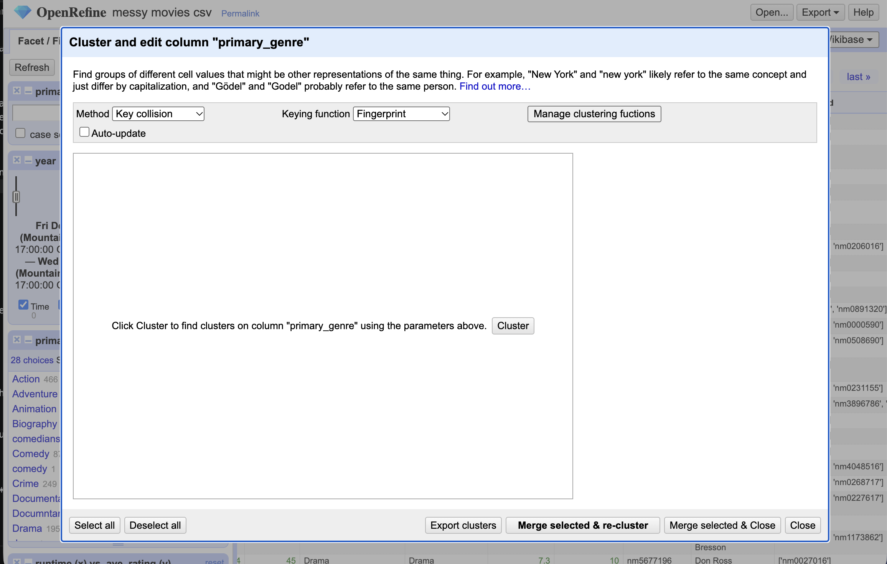
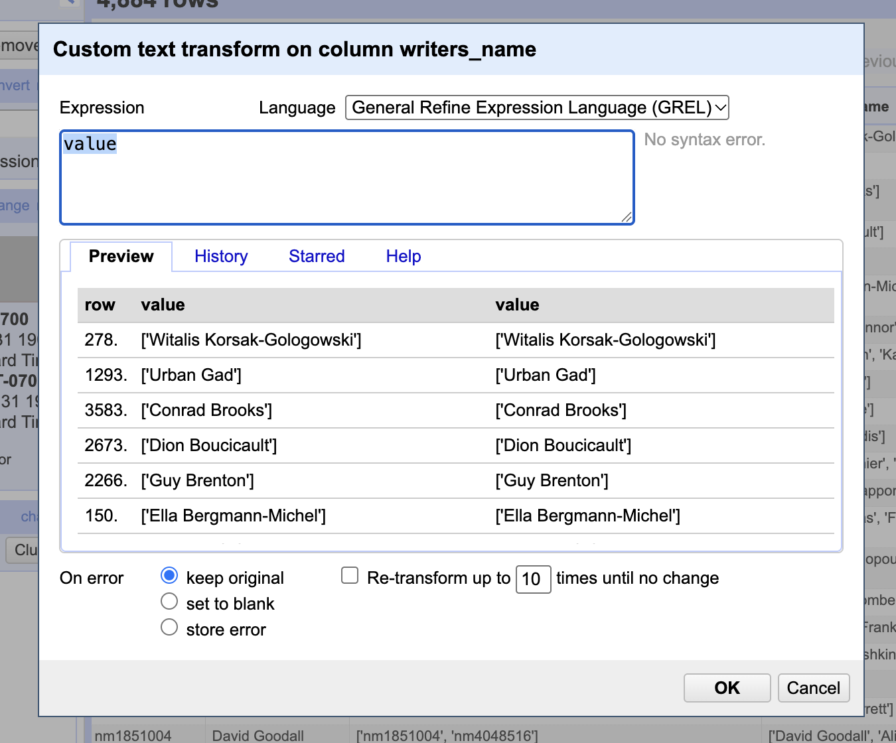

# Clusters and Transformations

In addition to the facetting, filtering, and sorting tools we've covered, you can also use OpenRefine's built-in clustering methods and transformation tools to inspect and clean your data. Clustering and transformation tools both let you change potentially large amounts of data all at once. 

## Clustering

Clustering refers to the process of finding groups of values that could be alternative representations of the same thing; for example, “New York” and “new york”, or “Gödel” and “Godel.” Because of this, clustering is a great way to identify and clean misspelled or mistyped entries in your data. 

OpenRefine has a number of [built-in clustering algorithms](https://openrefine.org/docs/technical-reference/clustering-in-depth) - feel free to play around with them and see what kinds of clusters come up. Broadly speaking, they offer two categories of clustering methods: token-based (key collision, n-gram...) and character-based (Levenshtein distance, PPM...). The fingerprinting method, a key collision method, is the least likely to produce a false positive, and so is the default clustering method in OpenRefine. 

You can access the clustering function by clicking the button `Cluster` in the top right hand corner of the facet box.

<figure markdown="span">
    {width=800}
    <figcaption></figcaption>
</figure>

In the primary_genre text facet we created earlier, click the `Cluster` button. A pop-up window will appear. Towards the top of the window, you will find dropdown menus for the clustering method and keying function; for this exercise, we will start by using the default (**Key collision** and **Fingerprint**, respectively) but feel free to try different combinations and see if different clusters emerge later on.

<figure markdown="span">
    {width=800}
    <figcaption></figcaption>
</figure>

Click on the `Cluster` button in the middle of the window. You should see three pairds of genre titles appear: 

- Drma <--> drma
- Sci-Fi <-> sci-fi
- Comedy <-> comedy

Select all the clustered pairs and press the `Merge selected & re-cluster` button. It should not return anymore clusters.

!!!note "Note"
    You'll notice that you can correct the new cell value in the same step as merging; for example, you could both merge 'Drma' and 'drma' and correct their new value to 'Drama'. We are not going to do that this time, however, to get a bit more practice with clustering :) 

Now, trying using different keying function and clustering method options. What other clusters appear, if any? 

???note "Solution"
     The combination of **Key collision** and **Metaphone3** should return the following cluster:

    - Drama <-> Drma

    Go ahead and merge these as Drama. 

Close the clustering window. Now you should see that your **primary_genre** facet only has 23 options. Scroll through it - are there any errors that we did not catch with the clustering methods?

???note "Solution"
    The various clustering functions will likely not have caught the following errors: 

    - comedians
    - science fiction
    
    These are two far away from the other genre titles, even though they refer to the same thing, and so won't be grouped in the clustering functions. These will have to be edited manually in the text facet box. Edit these entries as **Comedy** and **Sci-Fi**, respectively. 

## Transforming

Transforming data can also be a quick way to correct improperly formatted data all at once. OpenRefine includes a set of common transformations that you can use, and also allows for custom transformations. We've already encountered transformations that change data types, but there are also transformations that trim leading and trailing whitespace, or change the case of text. You can also write your own custom transformations.

<figure markdown='span'>
    {width=800}
    <figcaption></figcaption>
</figure>

### Trimming leading and trailing whitespace

One common use for transformations is to trim leading and trailing whitespaces. These are unnecessary, often accidental, spaces on either side of the text data in a cell. To access this transformation function, you'll need to:

1. Open the drop down menu beside the column title;
2. Hover over `Edit cells`;
3. Hover over `Common transforms`;
4. Click on `Trim leading and trailing whitespace`.

Try it now on the **movie_title** column. You should get a pop-up message confirming that you've changed 62 rows of data. 

Go through the other columns of text data and make sure that there is no trailing or leading whitepace.

### Custom transformations

We can also write our own transformations to edit large amounts of data easily. Let's try that now to turn our sets of writer IDs and names into simple and clean lists. To do this, we'll need to remove the square brackets and quotation marks around the ID numbers and names. 

Start by clicking the down arrow beside the **writer_names** variable title. Choose `Edit cells` and then `Transform`. This will open a pop up window for custom transformation. 

<figure markdown='span'>
    {width=800}
    <figcaption>You can also write your own custom transformations</figcaption>
</figure>

This window contains a text box, where you can type a General Refine Expression Language (GREL) and use it to transform your data. 

Our first step will be to remove all the square brackets. For this, type **value.replace("[","")** and click ok. This GREL expression is telling OpenRefine to take every **"["** and replace it with **""** (nothing). Helpfully, OpenRefine gives you a preview of the effect of your transformation on this 

Use this same technique to remove the other square brackets (]) and the quotation marks (').

??? note "Solution"
    You should use the following GREL expressions:

    - value.replace("]","")
    - value.replace("'","")

    After completing these two transformation, each row of writers' names should be a clean list, without any square brackets or quotation marks. 

We can also string these three replacement functions together, like so *value.replace(XX).replace(XX)...* and so on. 

Try removing the single quotation marks and the square brackets from the **writers_id** values in one transformation. 

???note "Solution"
    Open a custom transform window on the **writers_id** column and type in the following transformation expression:

    value.replace("[","").replace("]","").replace("'","")

