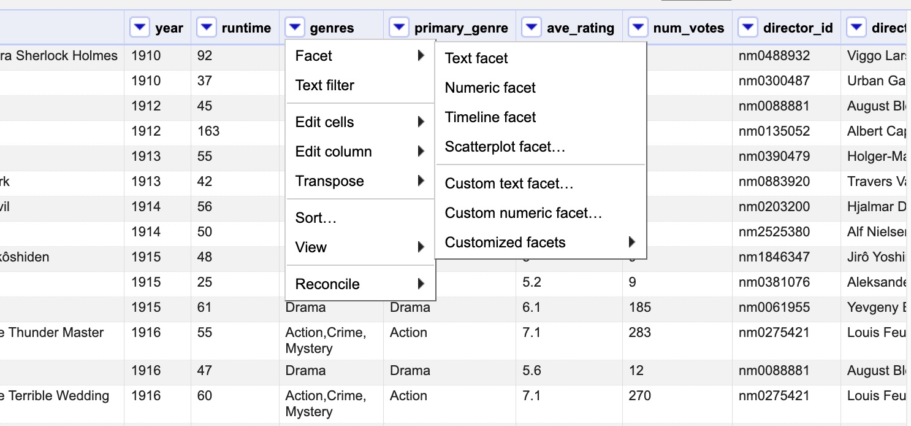
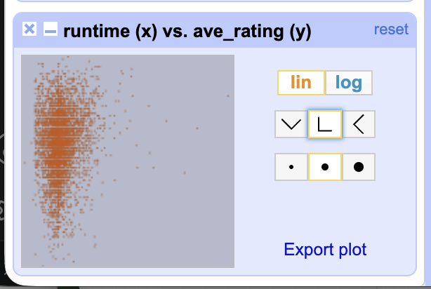

# Facets in OpenRefine

Facets are a useful (and powerful!) tool within OpenRefine for getting a big picture understanding of your data. Facetting groups all like values in a column together, and allows you to filter and edit those values en masse. Facets can also help you visualize your data. 

OpenRefine includes several options for facets, specifically: 

- Text facets
- Numerical facets
- Timeline/date facets
- Scatterplot facets 
- Custom

Text and timeline facets work much the same way: unique values are grouped together, and then listed along with the number of times that they appear in the column. 

Numeric and scatterplot facets, on the other hand, display graphs instead of lists. Scatterplots, moreover, allow you to visualise the values of a pair of numeric columns, and to filter data by two-value combinations. 

You can access the facetting options by clicking on the down arrow beside a variable title and then hovering over the `Facet` heading. 

## Text facets

First, let's try a text facet on the movie genre variable. A text facet groups all the identical text values in a column and creates a list in a box in the left margin with the unique text values and the number of times each value appears in the faceted column. 

Click the down arrow button beside the **primary_genre** title and hover over `Facet`, then click on `Text Facet`. 

<figure markdown="span">
    {width=800}
    <figcaption></figcaption>
</figure>
 
 A text facet should appear as a box, labelled with the variable being facetted, on the left hand side of your window. Your **primary_genre** facet should have 28 choices. These can be sorted either alphabetically by name, or by count in descending order. Scroll through the list of primary genres - do you notice any errors or issues? 

<figure markdown="span">
    {width=800}
    <figcaption></figcaption>
</figure>

You should see a number of mistyped or incorrectly labelled genre titles. Let's fix one of these.

Hover over the **Documntary** line and click on **edit** when the option appears. This will open a small text window that we can use to correct the mispelling. Correct the genre title and click `Apply`. Notice that the film that was incorrectly labelled has now been absorbed into the correctly spelled **Documentary** genre. 

Leave the other errors, we'll use other OpenRefine techniques to correct them. 

## Facets and working with numbers

Let's try creating a numeric facet to get a sense of the range of average ratings of the movies in our dataset. Start by pressing the down arrow button beside **ave_rating** and the hover other `Facet`. Select `Numeric facet` from the option. What happened?

???note "If something went wrong..."
    A facet labelled **ave_rating** should have appeared in the left pane in your window; however, it will not have a graph in it. Instead, it will have a message saying 'No numeric value present.' This is happening because our rating data is not correctly identified as numeric data. 

When a table is imported into OpenRefine, all columns are automatically considered to be text. To fix this, we can use transformations (we'll talk more about these in a little bit). 

We can transform text values into numbers by...

1. Navigating to the dropdown menu for the column;
2. Navigating to `Edit cells`;
3. Navigating to `Common transforms`; and
4. Selecting `to number`.

<figure markdown="span">
    {width=800}
    <figcaption></figcaption>
</figure>

Now, transform **ave_rating** from text to numeric data. Once that data has been formatted to numbers, you should see the values turn green and change from left-justified to right-justified. You should also see the numeric facet for movie rating automatically update now that there is numeric data in that column. 

Transform the other columns that are incorrectly formatted as text (**run_time**, **num_votes**, **year**).

!!!note "Note"
    You can format the **year** variable as a number or a date, depending on what you want to use it for. You should transform it into date data if you want to use a timeline facet, for example. If you want to use it in a scatterplot facet, for example to investigate the relationship between movie release year and runtime, then you would want to transform it into numeric data. 

Now that we have multiple numeric columns, we can use a scatterplot facet. Let's use one to look at the relationship between movie rating and movie length.

To do this, navigate to the **run_time** column, and click on the down arrow to access the drop down menu. From there, select **Facet** and then **Scatterplot facet...**. This will open a pop up window with a number of scatterplot option. When you hover over each, you should see a description of the variables appear. Which one should we select?

??? note "Solution"
    You want to select the graph that shows run_time(x) vs ave_rating (y).

What does the scatterplot tell us about the relationship between movie run time and movie rating? 

<figure markdown='span'>
    {width=800}
    <figcaption></figcaption>
</figure>

## Customized facets

Beyond the four primary facet options (text, numeric, timeline, and scatterplot) OpenRefine also includes a number of customized facets, and allows you to write your own custom text and numeric facets. 

One such useful customized facet is the facet by error. This will group your data by whether or not there are errors. Let's try making a facet by error for **runtime**. 

On my end, a facet appears in the left side pane, but with only one item ("false") and a count of 4884. This means that there are no errors in any of the 4884 rows in my dataset.

You can close a facet by clicking the `x` in the top right corner of the facet. 

Faceting is just one way to identify and correct errors. OpenRefine also allows us to use transformations and clustering, sometimes in conjunction with facets, to do that. 

