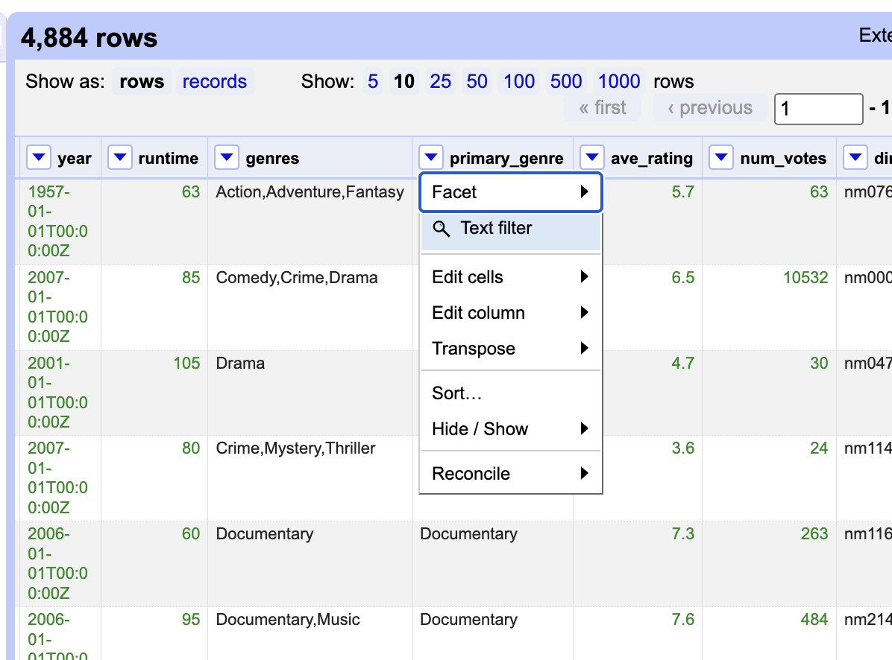
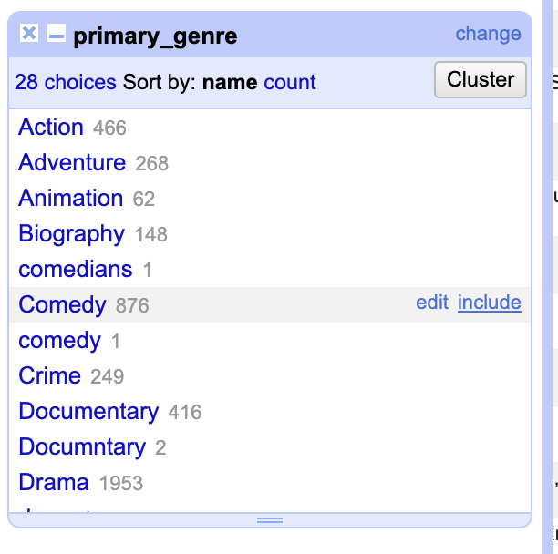
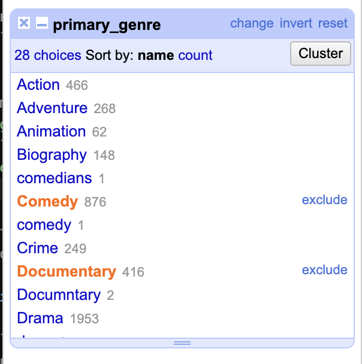
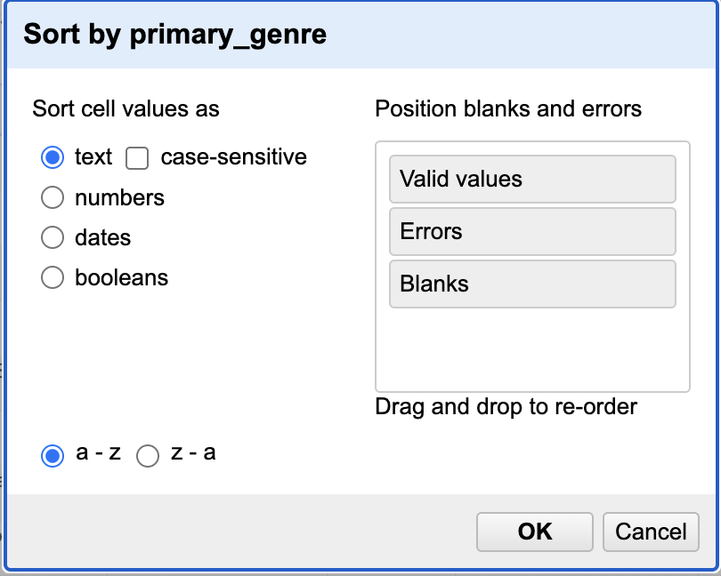
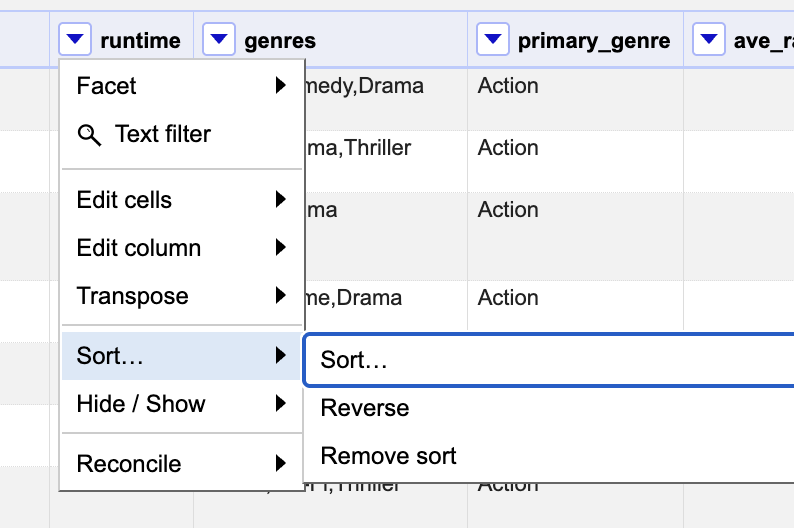
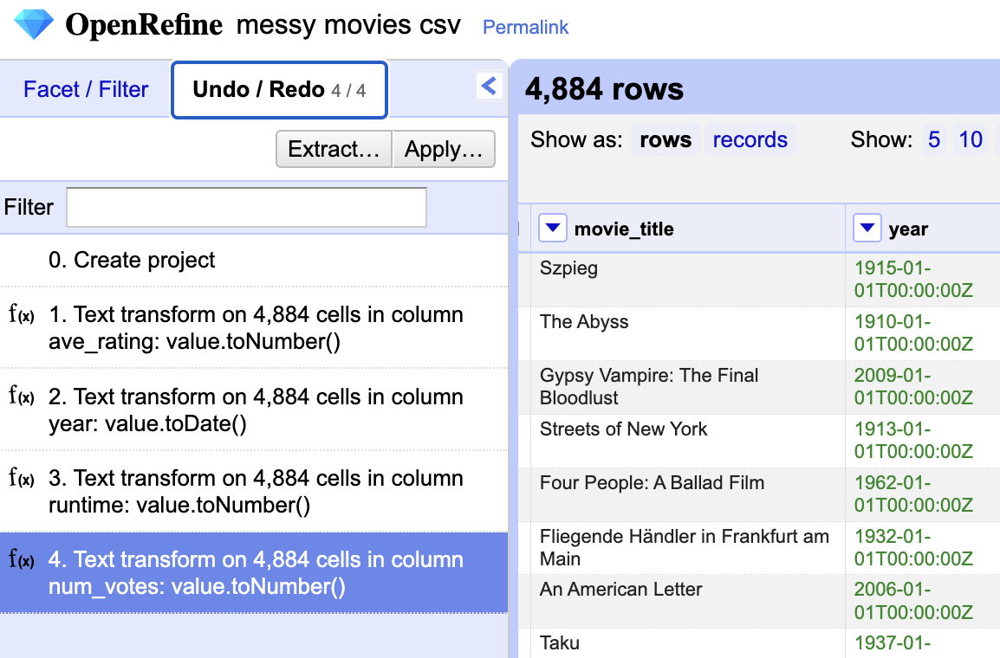
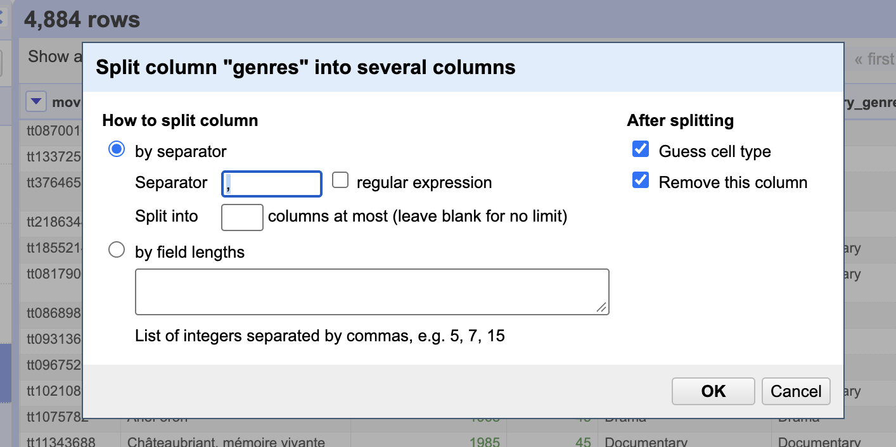

# Filtering and Sorting in OpenRefine

OpenRefine includes a set of functions that let you sort, filter, and include or exclude data. These tools allow you to focus in on a subset of your data and can be combined with other methods.

## Filtering

OpenRefine includes a built-in text filter, which you can find in the same dropdown menu as the facets we've been using.  

<figure markdown="span">
    {width=800}
    <figcaption></figcaption>
</figure>

Try filtering the **primary_genre** column. Select the `Text filter` option. You should see a filter box appear in the left hand marigin of your window. Start by typing **"fa"**. What happens? 

The text filter works in real time as you type. Once you've typed "fa" you should see your data restricted to only the family and fantasy genres. You can further narrow it down by typing more. 

Continue typing **ntasy** (so that you now have "fantasy"). You should now only have 32 entries on your browser window. You have succesfully filtered your data by fantasy genre!

Filters can be combined with facets. For example, let's take a look at the range of release dates for the fantasy movies in our dataset. Without removing the filter, create a timeline facet on the **year** variable. 

???note solution
    Navigate to the dropdown menu for the **year column**, then select `Facet` and `Timeline facet`. 

What does this tell us about the date range for the fantasy movies in our dataset?

Now, remove the filter before moving on to the next operations. 

!!! warning "How is filtering different from faceting?" 
    These two operations look very similar, but have slightly different functions. Simply put, faceting will give you an overview of all the data selected, while filtering will select out a subset of the data to work on. 

## Including and excluding

Including and excluding variable values is another fast way to subset your data. You can do this by hovering your cursor over an entry in a facet. When you do, options to edit and include or exclude will appear. 

Let's create a facet for **primary_genre** again. Hover over one of the entries in that facet and click on `include` when it appears. 

<figure markdown="span">
    {width=800}
    <figcaption>The include button appears inside the facet</figcaption>
</figure>

You should see that your data is now limited to just that one genre. Include a second genre of your choice - what happens now? 

??? note "Solution"
    When you include a second genre, your data will be filtered down to those two genres. The first will not be unselected.

There are three options to clearing the filter put on by including genres. First, you can close the facet. 

Next, you can click on `exclude` beside the entry in the text facet. Try doing this to one of the entries you included earlier. 

<figure markdown="span">
    {width=800}
    <figcaption></figcaption>
</figure>

Alternatively, you can click on the `reset` button in the top right hand corner of the facet box. Hit that button now, and it will reset any and all inclusions or exclusions you've made. 

## Sorting

Like filtering, sorting data is done through the column's dropdown menu (found by clicking the down arrow beside the title). 

When you click on `Sort...` a pop up window will appear. In that window, you will get the choice to sory by text, numbers, dates, or booleans (true or false). You will also be able to choose where the blanks and errors should go in the sorted results. 

Let's try sorting by text and by numbers. 

First, sort **primary_genre** by text. When you select `text` in the sorting pop up window, you will have the option of whether to sort from **a to z**, or **z to a**. Leave this at the default of **a to z**. Also leave the order of values, errors and blanks at the default.

<figure markdown="span">
    {width=800}
    <figcaption></figcaption>
</figure>

Second, sort **run_time** by number. Sort it from **largest first**. You'll also see an option to `sort by this column alone`. Leave it blank in this case, in order to sort the data by both **run_time** and **primary_genre**. You should now see the longest Action movie at the top of your table (*The Tiger and the Female*, at 180 minutes).

When you return to a column that you have already sorted, your options under `Sort...` will be slightly different. Now, you will see an option to `Sort...` (which will allow you to change your sorting options), `Reverse` (which will reverse the direction of the preexisting sort) , and `Remove sort` (this one is pretty self-explanatory).

<figure markdown="span">
    {width=800}
    <figcaption></figcaption>
</figure>

Let's say we want to find out what the shortest movie in the dataset it, irrespective of genre. To do this, we'll need to remove the sort on primary genre, and reverse the sort on movie runtime. Give it a try! What is the shortest movie in the dataset? 

???note "Solution"
    First, navigate to **primary_genre**, open the dropdown menu, hover over `Sort...` and select `Remove sort`.

    Now, navigate to the dropdown menu for **run_time**, hover over `Sort...` and select `Reverse`. 

    You should now get the movie "Szpieg" at the top of the table. This is the shortest movie in the dataset, at only 25 minutes long.

## Correcting mistakes

It's not uncommon to make a mistake, or to change your mind about something, when cleaning data. With this is mind, OpenRefine provides a very easy way to undo and redo any and all changes you've made. 

In the left hand pane, you should see a tab labelled **Undo/Redo**. Click on it. 

<figure markdown="span">
    {width=800}
    <figcaption></figcaption>
</figure>

Every operation you've run so far will be listed in this tab. To undo changes, all you have to do is click on a previous step. To redo that change, just click on it. 

Let's practice undoing a change by trying out another one of OpenRefine's column editing tools. Navitage to the **genres** variable and hover over `Edit column`. Select `Split into several columns...`. This will open a pop up window where you can specify how to split the column values up (by a separator or by number of characters), limit how many columns to create, and determine whether to delete the original column. Leave these at their defaults and click ok.

<figure markdown="span">
    {width=800}
    <figcaption></figcaption>
</figure>

You should now have three columns titled **genres 1**, **genres 2**, and **genres 3**. For some of the rows, **genres 2** and **genres 3** will be blank (in these cases, the movie only has one or two genres). 

Now, let's undo this change and return to our dataset with just the one **genres** column. Navigate to the **Undo/Redo** tab and select the action one above the split column action we just undertook. Your dataset should automatically revert. 
