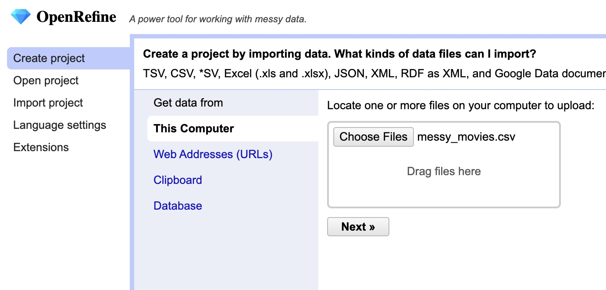
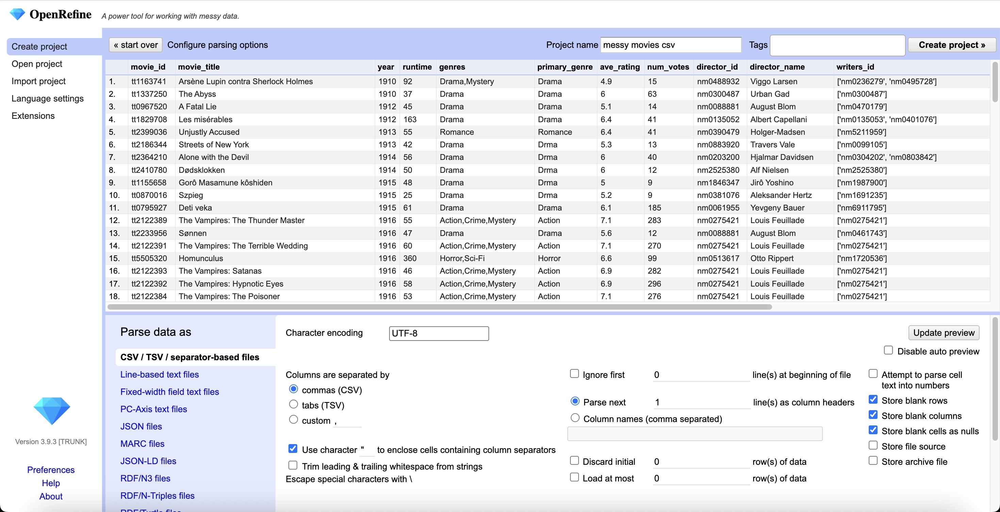

# Getting Started in OpenRefine

*What is OpenRefine?* [OpenRefine](https://openrefine.org/) is a free, open-source tool for cleaning and working with messy data. 

OpenRefine is user-friendly and powerful. It is a great tool for that first step of research analysis - data cleaning. Here are a few reasons to use it:

- OpenRefine automatically logs all actions;
- OpenRefine includes easy undo and redo tools;
- OpenRefine never modifies your original data, but rather saves your work to a new file;
- OpenRefine works with small and large(ish) datasets of up to 100,000 rows.

OpenRefine is also a great tool for working with data that requires privacy considerations. OpenRefine works by running a small server on your computer, meaning that all data is kept on your personal computer. It does not require an internet connection, even though it does open a browser window to allow easy interaction with the software. This means that you can use it locally and offline to clean data that you want to keep secure. 

## Launching OpenRefine

How you launch OpenRefine depends on what operating system you use. OpenRefine's [documentation](https://openrefine.org/docs/manual/running) includes detailed instructions for how to launch the program, but here are the basics for Mac and Windows systems: 

**Windows:** Once you've downloaded OpenRefine, navigate to the zipped file and extract it. Once it is unzipped, you can navigate into that directory and launch OpenRefine by opening `openrefine.exe`. This will launch a command prompt window, but just ignore that and wait for the browser to launch.  

**MacOS:** Once you've downloaded OpenRefine, open the DMG file that was downloaded. You'll be prompted to add OpenRefine to your Applications folder. Do that, and then navigate to it and launch it. It will launch as a browser window. 

In both cases, if OpenRefine does not automatically open in your browser, you can launch it by navigating to [http://127.0.0.1:3333/](http://127.0.0.1:3333/) or [http://localhost:3333](http://localhost:3333).

## Creating a project

Once OpenRefine is launched, you will see an options to create, open, or import projects. Under these options, you'll also see tabs for language settings and extensions. For this lesson, we will be creating a new project using our "messy_movies" data. Our data is in a csv (comma separated values) format, but OpenRefine will also accept data in tsv (tab separated values), xls, xlsx, JSON, and XML formats.

Click on `Create Project` and then on `This Computer`. From there, click on `Choose Files` and navigate to the messy_movies.csv file you downloaded earlier, and finally click `Next >>` to upload the data into OpenRefine.

<figure markdown="span">
    {width=800}
    <figcaption></figcaption>
</figure>

After uploading, OpenRefine will show you a preview of the data, giving you a chance to correct any issues in the upload before creating your project. You'll notice that OpenRefine will automatically parse the data as a file type (based on the file extension), but you can change how it parses the data if need be. 

<figure markdown="span">
    {width=800}
    <figcaption></figcaption>
</figure>

This is a great opportunity to double check that the file type was correctly identified, that your data was correctly parsed, and that all your variables are correctly titled. 

Our dataset includes almost 5000 movies (4884 to be precise) and 12 variables:

1. movie_id
2. movie_title
3. year
4. runtime
5. genres
6. primary_genre
7. ave_rating
8. num_votes
9. director_id
10. director_name
11. writers_id
12. writers_name

If everything looks right to you, you can click the `Create project >>` buton in the upper right corner. You now have a OpenRefine project!

Once you've created your project, it will automatically open as a interactive table. Each of your variables will make up a column, with every observation getting a row. Beside each column title (variable name) you'll see a down arrow button. Clicking this button will reveal a drop down menu with a number of tools for cleaning and inspecting your data. You can also choose how many rows are shown, and navigate between pages of rows. 

<figure markdown="span">
    {width=800}
    <figcaption></figcaption>
</figure>

On the left hand side of the window, you'll see a box with two tabs: **Facet/Filter** and **Undo/Redo**. We'll explore these tabs shortly. 

On the far right hand side, at the top of your window, you'll see a button labelled `Help`; you can click this to open OpenRefine's help documentation in a new tab. 

!!!note "Note."
    You can work on multiple OpenRefine projects at the same time. To open a second (or a third or a fourth) project, navigate to the `Open...` button in the top right hand corner. This will open the landing page again, where you can create a new project, open a project that already exists on your device, or import a project. 